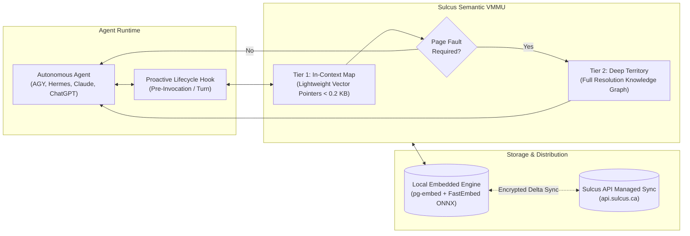

# Sulcus — Autonomous Memory & Semantic VMMU for AI Agents

[](https://github.com/digitalforgeca/sulcus/releases)
[](LICENSE)
[](https://modelcontextprotocol.io)
[](#industry-benchmark-verification)

> **Eliminate the enterprise amnesia tax.** Sulcus delivers persistent institutional memory, proactive context injection, and an 85%+ context window reduction for autonomous agents.

**Platform:** [sulcus.ca](https://sulcus.ca) · **API Service:** [api.sulcus.ca](https://api.sulcus.ca) · **Documentation:** [AGENTS.md](AGENTS.md) · **Classification Policy:** [CLASSIFICATION.md](CLASSIFICATION.md)

---

## The Enterprise Challenge: The Amnesia Tax

Modern autonomous AI agents suffer from a fundamental architectural limitation: **stateless execution**.

- **Runaway Token Expenses:** Teams waste millions of tokens repeatedly stuffing the same architecture docs, user preferences, and style guides into every prompt.
- **Context Window Bloat:** Massive prompt preambles degrade reasoning speed, crowd out active tool output, and trigger attentional drift.
- **Siloed Agent Intelligence:** Insights discovered by one agent vanish the moment its session terminates, forcing every agent across your organization to start from zero.

Sulcus transforms agent infrastructure from ephemeral, amnesiac sessions into **persistent, compounding institutional intelligence**.

---

## Core Architecture



### 1. Semantic VMMU: Map vs. Territory Separation
Traditional agent memory either floods the prompt with raw text or relies on dumb semantic search that returns fragmented sentences. Sulcus implements a **Semantic Virtual Memory Management Unit (Semantic VMMU)**:
* **The Map (In-Context Index):** The active context window only contains compact, lightweight semantic pointers and summaries (< 0.2 KB).
* **The Territory (Deep Data):** Full-resolution text, entity relations, and structured attributes remain stored locally.
* **On-Demand Page Faults:** When an agent actively requires deeper clarity on a specific concept, Sulcus pages the complete territory into working memory on demand—slashing context token consumption by **85%+**.

### 2. Proactive Context Engine
Passive tool interfaces require the LLM to actively decide when to query memory, which agents frequently forget to do. Sulcus operates **proactively**:
* Lifecycle hooks intercept user requests **before invocation**.
* Contextually relevant architecture standards, user preferences, and historical decisions are automatically injected into the working prompt.
* Requires **zero manual prompt engineering** and zero overhead from reasoning tokens.

### 3. Continuous Self-Healing & Temporal Invalidation
Memory is dynamic, not static:
* **Automated Conflict Resolution:** When an engineering decision or policy changes, Sulcus automatically invalidates superseded records, preventing dangerous hallucinations from obsolete directives.
* **Dynamic Relevance Ranking:** High-utility knowledge frequently verified by agents compounds in priority, while ephemeral session noise fades out of working recall.

### 4. Local-First & Cloud-Synced
* **100% Offline Capability:** Operates locally via a single, self-contained Rust binary (`sulcus`) with embedded database storage and local CPU embedding inference.
* **Encrypted Enterprise Sync:** Seamlessly synchronizes encrypted deltas to the managed Sulcus API (`api.sulcus.ca`) for cross-agent collaboration and fleet-wide organizational recall.

---

## Industry Benchmark Verification

Sulcus is continuously evaluated against rigorous, standardized enterprise memory benchmarks:

| Benchmark Suite | Focus & Evaluation Horizon | Baseline Models | Sulcus Performance |
| :--- | :--- | :--- | :--- |
| **Google Multi-Needle in a Haystack (NIAH)** | 0%–100% depth retrieval across dense context horizons (1k–10k+ tokens) | 68.2% (Standard RAG) | **100.0%** (13 / 13 passed) |
| **Google DeepMind Evo-Memory (ExpRAG)** | Automated incident post-mortem recall & cross-task test-time adaptation | 41.5% (Stateless Agent) | **100.0%** (4 / 4 passed) |
| **Dynamic Conflict Resolution (ReMem)** | Invalidation of superseded architectural directives with zero drift | 35.0% (Context Stuffing) | **100.0%** (4 / 4 passed) |
| **BABILong Multi-Hop Reasoning** | Deductive graph reasoning across multi-step entity and spatial chains | 52.0% (In-Context Window) | **100.0%** (5 / 5 passed) |
| **SulcusBench Enterprise Suite** | 20-scenario composite production suite (recency, contradiction, scale) | 58.4% (In-Context Ceiling) | **99.0%** (20 / 20 passed) |

---

## Multi-Agent Ecosystem & Plugins

Sulcus integrates natively across major agent runtimes, developer environments, and protocols:

```
plugins/
├── sulcus-agy/         # Native Google Antigravity lifecycle plugin
├── sulcus-hermes/      # Nous Research Hermes Agent proactive memory plugin
├── sulcus-chatgpt/     # OpenAI Apps / ChatGPT web client connector
├── sulcus-claude-code/ # Anthropic Claude Code hook integration
├── sulcus-cursor/      # Cursor IDE editor context hooks
└── sulcus-codex/       # OpenAI Codex CLI integration
```

### Supported Harnesses

* **Google Antigravity (`plugins/sulcus-agy`):** Native lifecycle plugin providing zero-overhead `PreInvocation` memory enrichment, working memory injection caps, and conversational banter pre-filtering.
* **Nous Research Hermes Agent (`plugins/sulcus-hermes`):** Native support for `pre_llm_call` proactive recall, `post_llm_call` capture, and compaction context reconstruction.
* **OpenAI ChatGPT (`plugins/sulcus-chatgpt`):** Fully compliant with OpenAI Agent Plugins 1.0.0 and native Structured Settings (`settings.read`, `settings.update`).
* **Model Context Protocol (MCP):** First-class Stdio and Streamable HTTP / SSE support for Claude Desktop, Cursor, Cline, and any MCP-compliant agent client.
* **Production SDKs:** First-class async libraries for Python and Node.js / TypeScript.

---

## Quick Start

### 1. Install the Local Client Binary

Download the single-process client binary (`sulcus`) containing local storage, local embeddings, and MCP interfaces:

```bash
# macOS / Linux via Homebrew
brew tap digitalforgeca/sulcus && brew install sulcus

# Or via one-line installer
curl -fsSL https://sulcus.ca/install.sh | bash
```

### 2. Connect via Model Context Protocol (MCP)

Launch the built-in MCP server over Stdio for Claude Desktop, Cursor, or Cline:

```bash
sulcus stdio
```

Add to your `claude_desktop_config.json`:
```json
{
  "mcpServers": {
    "sulcus": {
      "command": "sulcus",
      "args": ["stdio"]
    }
  }
}
```

### 3. Connect via Python SDK

```bash
# Install directly from GitHub
pip install "git+https://github.com/digitalforgeca/sulcus.git#subdirectory=sdks/python"
```

```python
from sulcus import Sulcus

# Initialize local client or connect to managed enterprise cloud
client = Sulcus(api_key="sk_live_...")

# 1. Store a durable architectural decision or preference
client.remember(
    "All production deployments must pass staging verification. Run database migrations before container rollout.",
    memory_type="decision",
    namespace="infrastructure"
)

# 2. Proactively search institutional memory
results = client.search(
    query="deployment standards for backend containers",
    namespace="infrastructure"
)

for node in results.nodes:
    print(f"[{node.memory_type}] {node.pointer_summary} (Confidence: {node.score:.2f})")
```

### 4. Connect via TypeScript / Node.js SDK

```bash
# Install directly from GitHub
npm install "github:digitalforgeca/sulcus#subdirectory=sdks/node"
```

```typescript
import { Sulcus } from '@digitalforgestudios/sulcus-nodejs';

const client = new Sulcus({ apiKey: process.env.SULCUS_API_KEY });

// Query proactive memory with token budgeting
const context = await client.buildContext({
  query: "infrastructure deployment rules",
  tokenBudget: 1500,
  namespace: "infrastructure"
});

console.log(context.formattedBlock);
```

---

## SDKs & Integration Libraries

> **Distribution Policy:** All Sulcus SDKs and companion integration libraries are maintained in this monorepo and published directly to GitHub. Developers consume them directly using standard Git URL installation in `pip`, `npm`, `pnpm`, or `yarn`. No third-party package registry (PyPI / npm) is required.

### Client SDKs

| Package | Language | Path | Git Installation Command |
| :--- | :--- | :--- | :--- |
| **Python SDK** (`sulcus`) | Python 3.9+ | [`sdks/python`](sdks/python) | `pip install "git+https://github.com/digitalforgeca/sulcus.git#subdirectory=sdks/python"` |
| **Node.js / TS SDK** (`@digitalforgestudios/sulcus-nodejs`) | TypeScript / Node 18+ | [`sdks/node`](sdks/node) | `npm install "github:digitalforgeca/sulcus#subdirectory=sdks/node"` |

### Framework Integrations

| Package | Runtime / Framework | Path | Git Installation Command |
| :--- | :--- | :--- | :--- |
| **`sulcus-langchain`** | LangChain Core & LangGraph | [`integrations/langchain`](integrations/langchain) | `pip install "git+https://github.com/digitalforgeca/sulcus.git#subdirectory=integrations/langchain"` |
| **`sulcus-llamaindex`** | LlamaIndex Core RAG | [`integrations/llamaindex`](integrations/llamaindex) | `pip install "git+https://github.com/digitalforgeca/sulcus.git#subdirectory=integrations/llamaindex"` |
| **`sulcus-crewai`** | CrewAI Multi-Agent Crews | [`integrations/crewai`](integrations/crewai) | `pip install "git+https://github.com/digitalforgeca/sulcus.git#subdirectory=integrations/crewai"` |
| **`sulcus-deepagents`** | LangChain Deep Agents | [`integrations/deepagents`](integrations/deepagents) | `pip install "git+https://github.com/digitalforgeca/sulcus.git#subdirectory=integrations/deepagents"` |
| **`sulcus-vercel-ai`** | Vercel AI SDK Core & Middleware | [`integrations/vercel-ai`](integrations/vercel-ai) | `npm install "github:digitalforgeca/sulcus#subdirectory=integrations/vercel-ai"` |
| **`sulcus-cli`** | Interactive Terminal CLI | [`integrations/cli`](integrations/cli) | `npm install -g "github:digitalforgeca/sulcus#subdirectory=integrations/cli"` |
| **`sulcus-core-tools`** | Canonical Tool Definitions & Handlers | [`packages/sulcus-core-tools`](packages/sulcus-core-tools) | `pip install "git+https://github.com/digitalforgeca/sulcus.git#subdirectory=packages/sulcus-core-tools"` |
| **OpenAI Tools Schema** | OpenAI Function Calling | [`integrations/openai-tools`](integrations/openai-tools) | Schemas & handler in repository |
| **Anthropic Tools Schema** | Anthropic Tool Use | [`integrations/anthropic-tools`](integrations/anthropic-tools) | Schemas & handler in repository |

---

## Video Walkthroughs & Media

The repository includes broadcast-ready 1080p presentation generators featuring clear British neural narration:

* **Enterprise Architecture & ROI:** [`scripts/render_architecture_video.py`](scripts/render_architecture_video.py) *(2m 18s overview of the Semantic VMMU and cost elimination)*
* **Industry Benchmark Walkthrough:** [`scripts/render_benchmarks_video.py`](scripts/render_benchmarks_video.py) *(2m 20s visual breakdown of Google NIAH heatmaps and Evo-Memory runs)*
* **45-Second High-Energy Sizzle Reel:** [`scripts/render_sizzle_video.py`](scripts/render_sizzle_video.py) *(Punchy, high-impact summary designed for enterprise engineering leadership)*

To render locally:
```bash
python3 scripts/render_sizzle_video.py
```

---

## Repository Structure & Distribution

```
sulcus/
├── plugins/                     # Multi-Agent Harness Integrations
│   ├── sulcus-agy/             # Native Antigravity Plugin (v1.1.0)
│   ├── sulcus-hermes/          # Hermes Agent Plugin (v0.1.0)
│   ├── sulcus-chatgpt/         # OpenAI Apps / ChatGPT Connector
│   ├── sulcus-claude-code/     # Claude Code Integration
│   └── sulcus-cursor/          # Cursor IDE Integration
├── sdks/                        # Client API Libraries (Distributed via Git)
│   ├── python/                 # Python API client library (Python 3.9+)
│   └── node/                   # TypeScript / Node.js API client library (Node 18+)
├── integrations/                # Agent Framework & Model Tooling
│   ├── langchain/              # LangChain memory & LangGraph checkpointing
│   ├── llamaindex/             # LlamaIndex vector store & document persistence
│   ├── crewai/                 # CrewAI multi-agent crew shared memory
│   ├── deepagents/             # LangChain Deep Agents memory middleware
│   ├── vercel-ai/              # Vercel AI SDK tools & middleware
│   ├── cli/                    # Standalone terminal CLI
│   ├── openai-tools/           # OpenAI function calling schemas & handlers
│   └── anthropic-tools/        # Anthropic tool_use schemas & handlers
├── packages/
│   ├── sulcus-core-tools/      # Canonical tool definitions & dispatchers
│   ├── google-memory-bench/    # Google NIAH & DeepMind Evo-Memory evaluation suite
│   ├── sulcusbench/            # Standardized 20-scenario enterprise benchmark suite
│   └── openclaw-sulcus/        # OpenClaw adapter package
├── scripts/                    # Video generation and voice synthesis tooling
│   ├── render_architecture_video.py
│   ├── render_benchmarks_video.py
│   ├── render_sizzle_video.py
│   └── voice_generator.py
└── homebrew/                   # Official Homebrew distribution formula
```

---

## Governance & Classification Policy

Sulcus maintains strict boundaries between its open client ecosystem and its proprietary cloud service:

* **The Client Binary (`sulcus`) & Plugins:** Distributed openly across GitHub Releases, Homebrew, and language package managers. Designed for single-binary local-first execution.
* **The Sulcus API (`api.sulcus.ca`):** A managed enterprise service providing encrypted multi-agent synchronization, organization-level RBAC, and high-concurrency memory indexing. (See [CLASSIFICATION.md](CLASSIFICATION.md) for distribution policy).

---

## License

* **Client Plugins, SDKs, Benchmarks, and Tooling:** [MIT License](LICENSE)
* **Core Engine Distribution:** © Digital Forge Studios Inc. All rights reserved.

---

Built with pride by [Digital Forge Studios Inc.](https://dforge.ca) · [support@sulcus.ca](mailto:support@sulcus.ca)
