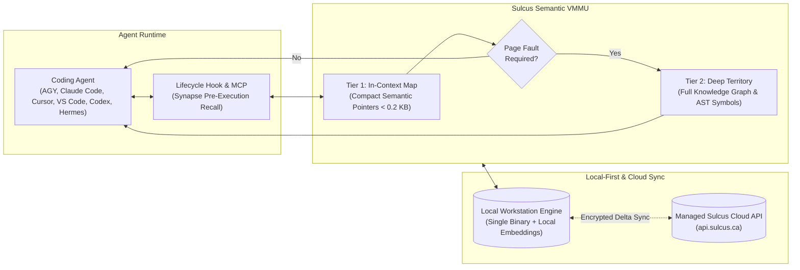

# SULCUS

[](https://github.com/digitalforgeca/sulcus/releases)
[](LICENSE)
[](https://modelcontextprotocol.io)
[](#benchmark-verification)

> **Your agents start every session from zero. Sulcus is the memory they keep.**

Stateless AI sessions lose architectural decisions, debugging root causes, and user preferences the moment a conversation ends. Sulcus gives coding assistants and autonomous agents persistent, thermodynamic memory — keeping compact semantic pointers in context and paging full details on demand.

**Website:** [sulcus.ca](https://sulcus.ca) · **Cloud API:** [api.sulcus.ca](https://api.sulcus.ca) · **Documentation:** [sulcus.ca/docs](https://sulcus.ca/docs)

---

## Core Architecture



### 1. Semantic VMMU: Map vs. Territory Separation
Sulcus implements a **Semantic Virtual Memory Management Unit** for context windows:
- **The Map:** Working context receives compact telegraphic pointers under 0.2 KB rather than raw transcript dumps.
- **The Territory:** Full-resolution notes, entity triples, and AST symbol hierarchies remain indexed on disk.
- **On-Demand Page Faults:** Agents expand deep territory only when needed (`expand_memory`), cutting prompt token overhead by **85%+**.

### 2. System 1 (`VCR`) Curation & Synapse Recall
- **System 1 (`VCR`) Ingestion:** Evaluates durability, novelty, and operational utility before storing memories, filtering conversational noise automatically.
- **Synapse Pre-Execution Recall:** Lifecycle hooks surface relevant architectural rules, past bug fixes, and AST PageRank context before the model acts.
- **Temporal Invalidation:** Newer verified facts automatically supersede outdated directives so stale decisions stop resurfacing.

### 3. Local-First Workstation Binary + Managed Cloud API
- **100% Offline Capable:** Runs locally via a single native `sulcus` workstation binary with local CPU embeddings and MCP stdio/proxy support.
- **Managed Cloud Sync:** Optional encrypted delta sync with [api.sulcus.ca](https://api.sulcus.ca) keeps your personal or project namespaces available across workstations and tools.

---

## Benchmark Verification

| Benchmark Suite | Evaluation Focus | Baseline | Sulcus |
| :--- | :--- | :--- | :--- |
| **Google Multi-Needle in a Haystack (NIAH)** | 0%–100% depth retrieval across dense context horizons | 68.2% (Standard RAG) | **100.0%** (13 / 13) |
| **Google DeepMind Evo-Memory (ExpRAG)** | Incident post-mortem recall & cross-task adaptation | 41.5% (Stateless Agent) | **100.0%** (4 / 4) |
| **Dynamic Conflict Resolution (ReMem)** | Invalidation of superseded architectural directives | 35.0% (Context Stuffing) | **100.0%** (4 / 4) |
| **BABILong Multi-Hop Reasoning** | Deductive graph reasoning across multi-step chains | 52.0% (In-Context Window) | **100.0%** (5 / 5) |
| **SulcusBench Composite Suite** | 20-scenario recall, temporal recency, contradiction & scale | 58.4% (In-Context Ceiling) | **99.0%** (20 / 20) |

---

## 17 Harness & IDE Plugins

All official harness integrations live under [`plugins/`](plugins) with unified single-binary `sulcus` hook and MCP wiring:

| Plugin | Target Harness / IDE | Path |
| :--- | :--- | :--- |
| **`sulcus-agy`** | Google Antigravity (`hooks.json` lifecycle + skill) | [`plugins/sulcus-agy`](plugins/sulcus-agy) |
| **`sulcus-claude-code`** | Anthropic Claude Code (`hooks.json` + `sulcus mcp-proxy`) | [`plugins/sulcus-claude-code`](plugins/sulcus-claude-code) |
| **`sulcus-cursor`** | Cursor IDE (`.cursor/hooks.json` + `sulcus mcp-proxy`) | [`plugins/sulcus-cursor`](plugins/sulcus-cursor) |
| **`sulcus-windsurf`** | Windsurf Cascade (`.windsurf/hooks.json` + `sulcus mcp-proxy`) | [`plugins/sulcus-windsurf`](plugins/sulcus-windsurf) |
| **`sulcus-codex`** | OpenAI Codex CLI (`hooks.json` + `sulcus mcp-proxy`) | [`plugins/sulcus-codex`](plugins/sulcus-codex) |
| **`sulcus-gemini`** | Gemini CLI (`hooks/hooks.json` + `sulcus mcp-proxy`) | [`plugins/sulcus-gemini`](plugins/sulcus-gemini) |
| **`sulcus-vscode`** | VS Code & GitHub Copilot (`sulcus stdio` + extension) | [`plugins/sulcus-vscode`](plugins/sulcus-vscode) |
| **`sulcus-jetbrains`** | IntelliJ IDEA, RubyMine & JetBrains IDEs | [`plugins/sulcus-jetbrains`](plugins/sulcus-jetbrains) |
| **`sulcus-junie`** | JetBrains Junie (`hooks/hooks.json` + `sulcus mcp-proxy`) | [`plugins/sulcus-junie`](plugins/sulcus-junie) |
| **`sulcus-cline`** | Cline / Roo Code (`.clinerules/hooks` + `sulcus mcp-proxy`) | [`plugins/sulcus-cline`](plugins/sulcus-cline) |
| **`sulcus-opencode`** | OpenCode (`sulcus-opencode.mjs` + `sulcus mcp-proxy`) | [`plugins/sulcus-opencode`](plugins/sulcus-opencode) |
| **`sulcus-hermes`** | Nous Research Hermes Agent (`ContextEngine` + `sulcus stdio`) | [`plugins/sulcus-hermes`](plugins/sulcus-hermes) |
| **`sulcus-continue`** | Continue (`sulcus-context-provider.mjs` + `sulcus mcp-proxy`) | [`plugins/sulcus-continue`](plugins/sulcus-continue) |
| **`sulcus-aider`** | Aider (`aider-sulcus.sh` + `sulcus hook --harness aider`) | [`plugins/sulcus-aider`](plugins/sulcus-aider) |
| **`sulcus-zed`** | Zed (`extension.toml` + `sulcus mcp-proxy`) | [`plugins/sulcus-zed`](plugins/sulcus-zed) |
| **`sulcus-neovim`** | Neovim (`sulcus.nvim` Lua plugin) | [`plugins/sulcus-neovim`](plugins/sulcus-neovim) |
| **`sulcus-chatgpt`** | OpenAI ChatGPT / Apps (Remote Streamable HTTP MCP) | [`plugins/sulcus-chatgpt`](plugins/sulcus-chatgpt) |

---

## Quick Start

### 1. Install the Workstation CLI

```bash
# Official installer
curl -fsSL https://sulcus.ca/install.sh | bash

# Or via Homebrew on macOS / Linux
brew tap digitalforgeca/sulcus && brew install sulcus
```

### 2. Wire MCP & Hooks Automatically

```bash
sulcus login
sulcus connect
sulcus doctor
```

For manual MCP configuration (or 100% offline local mode via `["stdio"]`):

```json
{
  "mcpServers": {
    "sulcus": {
      "command": "sulcus",
      "args": ["mcp-proxy"]
    }
  }
}
```

### 3. Python SDK (`sulcus`)

```bash
pip install "git+https://github.com/digitalforgeca/sulcus.git#subdirectory=sdks/python"
```

```python
import os
from sulcus import Sulcus

client = Sulcus(api_key=os.environ["SULCUS_API_KEY"])

client.remember(
    "Run database migrations before rolling out application workers.",
    memory_type="procedural",
    namespace="infrastructure",
)

results = client.search(
    query="deployment order for application workers",
    namespace="infrastructure",
)

for node in results:
    print(f"[{node.memory_type}] {node.pointer_summary} (heat={node.current_heat:.2f})")
```

### 4. TypeScript / Node.js SDK (`sulcus`)

```bash
git clone https://github.com/digitalforgeca/sulcus.git
cd sulcus/sdks/node && npm install && npm run build
```

```typescript
import { Sulcus } from 'sulcus';

const client = new Sulcus({ apiKey: process.env.SULCUS_API_KEY });

const context = await client.buildContext({
  query: 'deployment order for application workers',
  tokenBudget: 1500,
  namespace: 'infrastructure',
});

console.log(context.formattedBlock);
```

---

## SDKs, Framework Integrations & Packages

| Component | Runtime / Ecosystem | Path |
| :--- | :--- | :--- |
| **Python SDK** (`sulcus`) | Python 3.9+ (sync + async, zero external deps) | [`sdks/python`](sdks/python) |
| **Node.js / TS SDK** (`sulcus`) | Node.js 18+ / TypeScript | [`sdks/node`](sdks/node) |
| **`sulcus-langchain`** | LangChain Core & LangGraph | [`integrations/langchain`](integrations/langchain) |
| **`sulcus-llamaindex`** | LlamaIndex RAG & Vector Store | [`integrations/llamaindex`](integrations/llamaindex) |
| **`sulcus-crewai`** | CrewAI Memory Storage & Tools | [`integrations/crewai`](integrations/crewai) |
| **`sulcus-deepagents`** | LangChain Deep Agents Middleware | [`integrations/deepagents`](integrations/deepagents) |
| **`sulcus-vercel-ai`** | Vercel AI SDK Core & Middleware | [`integrations/vercel-ai`](integrations/vercel-ai) |
| **`sulcus-cli`** | Interactive TypeScript Terminal Helper | [`integrations/cli`](integrations/cli) |
| **`sulcus-core-tools`** | Canonical OpenAI / Anthropic / Gemini Tool Dispatchers | [`packages/sulcus-core-tools`](packages/sulcus-core-tools) |
| **`openclaw-sulcus`** | OpenClaw Context Engine Adapter | [`packages/openclaw-sulcus`](packages/openclaw-sulcus) |
| **`sulcusbench`** | 20-Scenario Memory Evaluation Suite | [`packages/sulcusbench`](packages/sulcusbench) |
| **`google-memory-bench`** | NIAH, Evo-Memory & BABILong Suite | [`packages/google-memory-bench`](packages/google-memory-bench) |

---

## License

Client SDKs, harness plugins, integration adapters, evaluation suites, and documentation in this repository are released under the [MIT License](LICENSE). See [LICENSE](LICENSE) for full terms and proprietary runtime/service reservations.

Built by Digital Forge Studios Inc. · [sulcus.ca](https://sulcus.ca) · [support@sulcus.ca](mailto:support@sulcus.ca)
